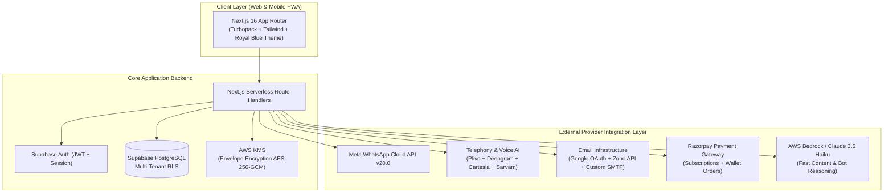
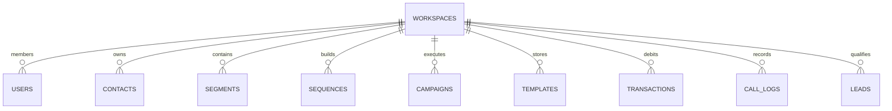

# Leadpilot — Product Requirements Document (PRD)
**Autonomous Multi-Channel Sales Workforce Engine (RapidSales AI Specification)**

---

## Document Control
* **Product Name**: Leadpilot
* **Reference Benchmark**: RapidSales AI (`https://app.rapidsales.ai/`)
* **Version**: 2.1.0 (Production Master Specification)
* **Author**: Leadpilot Product & Engineering Team
* **Status**: Complete, Verified & Synced

---

## Table of Contents
1. [Executive Summary & Product Vision](#1-executive-summary--product-vision)
2. [Target Audience & Ideal Customer Profile (ICP)](#2-target-audience--ideal-customer-profile-icp)
3. [System Architecture & Technology Stack](#3-system-architecture--technology-stack)
4. [Functional Modules Specification (13 Core Modules)](#4-functional-modules-specification-13-core-modules)
   * [Module 1: Authentication, Onboarding & Multi-Tenancy](#module-1-authentication-onboarding--multi-tenancy)
   * [Module 2: Executive Dashboard & Real-Time Telemetry](#module-2-executive-dashboard--real-time-telemetry)
   * [Module 3: Audience Hub (Contacts & Lifecycle Segments)](#module-3-audience-hub-contacts--lifecycle-segments)
   * [Module 4: Campaigns Engine & Multi-Channel Sequence Builder](#module-4-campaigns-engine--multi-channel-sequence-builder)
   * [Module 5: WhatsApp Cloud API Suite](#module-5-whatsapp-cloud-api-suite)
   * [Module 6: WhatsApp Official Blue Tick (OBA) Verification Hub](#module-6-whatsapp-official-blue-tick-oba-verification-hub)
   * [Module 7: AI Voice Calling Suite (11 Indian Languages)](#module-7-ai-voice-calling-suite-11-indian-languages)
   * [Module 8: Cold Email Infrastructure Suite](#module-8-cold-email-infrastructure-suite)
   * [Module 9: Qualified Leads CRM Hub](#module-9-qualified-leads-crm-hub)
   * [Module 10: Automation Reports & Channel Analytics](#module-10-automation-reports--channel-analytics)
   * [Module 11: Working Hours & Compliance Governance](#module-11-working-hours--compliance-governance)
   * [Module 12: Billing, Subscriptions & Universal Credit Wallet](#module-12-billing-subscriptions--universal-credit-wallet)
   * [Module 13: Profile, Security & Organization Management](#module-13-profile-security--organization-management)
5. [Third-Party APIs & Environment Variables Master Directory](#5-third-party-apis--environment-variables-master-directory)
6. [Database Schema & Data Models (PostgreSQL / Supabase)](#6-database-schema--data-models-postgresql--supabase)
7. [Inbound E-Commerce & Lead Ads Webhook Integrations](#7-inbound-e-commerce--lead-ads-webhook-integrations)
8. [AI Content Creators & Prompt Engineering Engine](#8-ai-content-creators--prompt-engineering-engine)
9. [Production Webhook Event Payloads & Schemas](#9-production-webhook-event-payloads--schemas)
10. [Unit Economics, Pricing & Margin Analysis](#10-unit-economics-pricing--margin-analysis)
11. [Regulatory Compliance & Security Architecture](#11-regulatory-compliance--security-architecture)
12. [Step-by-Step Provider Setup Guides](#12-step-by-step-provider-setup-guides)
13. [Production Deployment & Launch Checklist](#13-production-deployment--launch-checklist)

---

## 1. Executive Summary & Product Vision

**Leadpilot** is an enterprise-grade autonomous sales workforce platform engineered to clone and outperform RapidSales AI (`app.rapidsales.ai`). It unifies the three highest-converting outreach channels:
1. **Conversational AI Voice Calling** (Human-grade speech synthesis in 11 Indian regional languages with DTMF IVR menus).
2. **Official WhatsApp Cloud API** (Dual onboarding model, automated bot knowledge bases, Shopify recovery, and Meta Blue Tick filing).
3. **High-Deliverability Cold Email** (1-click Google OAuth / Zoho Mail sync, custom SMTP/IMAP handshakes, and automated SPF/DKIM/DMARC DNS generators).

Unlike fragmented SaaS tools that require 4 to 6 separate subscriptions, Leadpilot consolidates messaging, dialers, CRM qualification, and email warm-ups into a **Single Universal Wallet** (`₹1 = 1 Credit`), driving down customer acquisition costs (CAC) while delivering 95%+ gross margins for the SaaS operator.

---

## 2. Target Audience & Ideal Customer Profile (ICP)

* **Direct-to-Consumer (D2C) Brands & E-commerce**: Abandoned cart recovery, COD confirmation calls, dispatch tracking on WhatsApp, RTO reduction.
* **B2B SaaS & Tech Startups**: Outbound cold email cadences, multi-touch sequences, automated rep meeting bookings.
* **Real Estate & High-Ticket Consultancies**: Instant lead qualification, automated round-robin sales agent routing, AI phone call screening.
* **Education & Ed-Tech**: Seminar registration follow-ups, fee reminder calls, WhatsApp student onboarding drips.

---

## 3. System Architecture & Technology Stack



* **Frontend**: Next.js 16.4 (Turbopack), React 19, TypeScript (Strict), Lucide Icons, Custom Royal Blue Design System (`#2563eb`, `#0f172a`, `#38bdf8`).
* **Backend & Database**: Supabase PostgreSQL with Row Level Security (RLS), Edge Middleware for multi-tenant tenant isolation.
* **Encryption**: AWS KMS Envelope Encryption (`AES-256-GCM`) for storing third-party API tokens (Meta permanent tokens, SMTP passwords, Plivo auth secrets).
* **AI Orchestration**: AWS Bedrock (Anthropic Claude 3.5 Haiku) for sub-second copy generation, inbound WhatsApp bot replies, and call summarization.

---

## 4. Functional Modules Specification (13 Core Modules)

### Module 1: Authentication, Onboarding & Multi-Tenancy
* **Routes**: `/login`, `/signup`, `/recover`, `/dashboard`
* **Features**:
  * Clean Royal Blue authentication card with real-time pilot telemetry widget.
  * Email & Password authentication with bcrypt hashing + CSRF tokens.
  * Super Admin view with tenant impersonation bar (`SUPER ADMIN VIEW: Viewing isolated client workspace`).
  * 4-step Industry Onboarding Wizard (E-Commerce, Real Estate, B2B SaaS, Agency) pre-populating sequences and templates.

### Module 2: Executive Dashboard & Real-Time Telemetry
* **Metrics Grid**: Wallet balance (Credits), Total spend (₹), Total contacts, Reply rate (%).
* **Channel Performance Cards**:
  * **Email**: Sent, Delivered, Opened, Replied, Bounced, Spam complaints, Cost.
  * **WhatsApp**: Sent, Delivered, Read, Replied, Failed, Cost, Auto-replies ledger.
  * **AI Calling**: Total calls, Completed, Failed, Average duration, Cost.
* **Time Filters**: All, Today, Yesterday, This Week, Last Week, This Month, Last Month, This Year, Custom Date Range.
* **Quick Actions**: New Campaign, Import Contacts, Email Inbox, WhatsApp Inbox, Lead List.

### Module 3: Audience Hub (Contacts & Lifecycle Segments)
* **Contacts Table**: Search by name/phone/email, multi-tag filtering, consent status (`Verified`, `Pending`, `Opt-Out`).
* **Country-Scoped Importer**:
  * Bulk CSV upload with visual column mapping (Name, Phone, Email, Company, Tags).
  * Auto-prepend country code selector (Default `+91 India`, UAE `+971`, US `+1`, UK `+44`).
  * Deduplication engine against existing database phone numbers and emails.
  * 1-click Download Sample CSV template.
* **Dynamic Segments**:
  * Filter criteria builder (Tag matches, channel consent, engagement status).
  * Status Lifecycle: `Active`, `Draft`, `Archived`.
  * Status filter bar (`All`, `Active`, `Draft`, `Archived`).
  * 1-click Archive/Unarchive actions directly on cards.

### Module 4: Campaigns Engine & Multi-Channel Sequence Builder
* **Campaigns Table**: Filter by channel, status (`Active`, `Draft`, `Completed`, `Paused`), priority (`High`, `Normal`, `Low`).
* **Prerequisite Guard Modal**: Clicking *"New Campaign"* when sequences are empty triggers the exact RapidSales guard:
  * Title: *"Create a sequence first"*
  * Body: *"You don't have any sequences yet. A campaign needs a sequence to run against — build one in the Sequence Builder and then come back here to launch your campaign."*
  * Actions: *"Cancel"* & *"Create Sequence"* (redirects directly to `/sequences`).
* **Drag-and-Drop Sequence Builder**:
  * Action nodes: WhatsApp Message, AI Voice Call, Cold Email.
  * Logic nodes: Delay (Minutes, Hours, Days), If Replied Condition, If Call Answered Condition.
  * Handoff triggers: Auto-create follow-up task on human reply.

### Module 5: WhatsApp Cloud API Suite
* **Dual Connection Onboarding Model**:
  1. **Direct Mode (Meta Embedded Signup)**:
     * 5-step animated modal simulating the Meta Login dialog:
       * Step 1: Meta window login / business verify
       * Step 2: Permanent token exchange
       * Step 3: Webhook subscription
       * Step 4: Finding number & WABA
       * Step 5: Activating number & 6-digit PIN
  2. **Manual Mode (BYOK)**:
     * Configuration modal with Phone Number, Delay, Phone ID, WABA ID, Meta App ID, Meta App Secret, Permanent Access Token, Webhook URL, Verify Token, and live *"Test Connection"* ping against `/api/integrations/test`.
* **Connected Phone Card**: Shows Mode (`DIRECT EMBEDDED` or `MANUAL BYOK`), Quality Rating (`High (Green)`), Daily Limit (`Tier 2 - 10k/day`), Webhook status (`Active`), and *"Apply for Blue Tick"* navigation.
* **Live 2-Way Inbox**: Threaded customer conversations, HSM template sender, canned replies, human takeover toggle.
* **AI Bot Flow Builder**: Trigger keywords, condition matching, Knowledge Base semantic search fallback.

### Module 6: WhatsApp Official Blue Tick (OBA) Verification Hub
* **0–100% Readiness Audit Score**:
  * Criterion 1: Meta Business Manager Verified (30%)
  * Criterion 2: 2-Step Verification PIN Active (15%)
  * Criterion 3: Official Business Website with matching domain & email (20%)
  * Criterion 4: Brand Notability & Press Articles (35%)
* **Dossier Submission Wizard**:
  * Meta Business Manager ID, Registered Legal Entity Name & Trade License / Incorporation Certificate, Brand Wikipedia URL, up to 5 Top-Tier PR & Press Article Links.

### Module 7: AI Voice Calling Suite (11 Indian Languages)
* **Voice Dashboard**: Completed calls, failed calls, average duration, sentiment distribution, cost counter.
* **Call Center**: Live browser dialer, microphone testing, live audio stream visualizer.
* **Agent Builder**:
  * 3 Operational Modes: *Conversational*, *Scripted*, and *IVR Menu*.
  * Pronunciation Dictionary: Custom phonetic overrides for Indian brand names.
  * Knowledge Base Upload: PDF/DOCX indexing for answering questions during live calls.
  * Indian Languages: English (Indian), Hindi, Hinglish, Gujarati, Tamil, Telugu, Marathi, Kannada, Bengali, Malayalam, Punjabi.
* **Visual IVR Phone Menu Builder**: DTMF Keypad Tree Builder (COD confirmation, order status, human rep transfer) with built-in keypad simulator.

### Module 8: Cold Email Infrastructure Suite
* **Mail Setup Tab**:
  * *Gmail*: 1-click Google OAuth 2.0 authorization with daily limit (250/day) & delay throttle (30s) controls.
  * *Zoho Mail*: Exact 2-step setup modal with link to Zoho API Console, App Password generation instructions, and IMAP enablement guide.
  * *Custom SMTP / IMAP*: Host, port, username, password with live TLS 1.3 handshake ping.
  * *Connected Mailboxes Table*: Deliverability health badges (**SPF ✓, DKIM ✓, DMARC ✓**).
* **Sender Identities Tab**:
  * Cryptographic DNS TXT record generator with 1-click copy buttons for SPF, DKIM (RSA 2048-bit), DMARC, and MX.

### Module 9: Qualified Leads CRM Hub
* **Auto-Assign**: Round-robin distribution across active sales reps with daily caps, routing strategies, and instant WhatsApp rep alerts.
* **Custom Outcomes**: Dynamic qualification tag builder (e.g., `COD Confirmed`, `High Intent (₹50k+)`, `Schedule Field Visit`).
* **Buckets (Kanban)**: 4-column drag-and-drop pipeline: `New Qualified` $\rightarrow$ `AI Contacted` $\rightarrow$ `Demo / Proposal` $\rightarrow$ `Closed Won`.
* **Alerts & Webhooks**: Instant WhatsApp rep alerts + real-time JSON webhooks for Slack, Discord, and CRMs.
* **Manual Leads**: Quick modal to insert qualified prospects directly into the CRM.

### Module 10: Automation Reports & Channel Analytics
* **E-Commerce Reports**: Abandoned Cart Recovery Rate (%), COD Confirmation Rate (%), Dispatch Tracking Opens (%).
* **Analytics**: Message volume graphs, per-channel conversion comparisons, acquisition costs.

### Module 11: Working Hours & Compliance Governance
* **Working Days Schedule**: 7-day granular schedule with start/end times, per-channel enforcement, Saturday/Sunday skip, and timezone hold engine.
* **API Keys Management**: Generate, rotate, and revoke REST API keys for headless API access.

### Module 12: Billing, Subscriptions & Universal Credit Wallet
* **Monthly Subscription Tiers**:
  * **Basic**: ₹3,000/mo (Annual: ₹2,125/mo — Save 29%) · 100 Shared Credits · 2 Languages, 4 Voices · 2 Email accounts.
  * **Advance (🔥 POPULAR)**: ₹6,000/mo (Annual: ₹4,250/mo — Save 29%) · 250 Shared Credits · 4 Languages, 8 Voices · 5 Email accounts · AI WhatsApp Auto-Reply.
  * **Pro**: ₹12,000/mo (Annual: ₹8,500/mo — Save 29%) · 500 Shared Credits · 10 Languages, 20 Voices · 10 Email accounts · 3,000 Call Recording mins · Blue Tick filing.
  * **WhatsApp Only Advance**: ₹1,999/mo (Annual: ₹1,499/mo) · 250/day (Meta Tier Based) · Abandoned Cart notifications · Shopify & Meta/Google leads webhooks.
* **Credit Usage Estimator Modal**:
  * Presets: Starter (₹400), Growth (₹2,000), Pro (₹7,800), Scale (₹30,800).
  * Dynamic formula input: `emails * 0.09 + callMinutes * 3.10`.
* **Universal Shared Wallet Engine**: `1 Credit = ₹1 INR`. Auto-pause guard preventing negative balances.

### Module 13: Profile, Security & Organization Management
* Personal Details (First Name, Last Name), Contact Details (Email, Phone `+91 8200010241`).
* Change Password modal with visibility eye toggles.
* Organization & Multi-Workspace Switcher.

---

## 5. Third-Party APIs & Environment Variables Master Directory

| # | Provider / Service | Environment Variable | Where to Obtain | Purpose in Leadpilot | Raw Cost / Pricing |
| :---: | :--- | :--- | :--- | :--- | :--- |
| **1** | **Razorpay** | `RAZORPAY_KEY_ID`<br>`RAZORPAY_KEY_SECRET`<br>`RAZORPAY_WEBHOOK_SECRET` | [dashboard.razorpay.com](https://dashboard.razorpay.com/) $\rightarrow$ Settings $\rightarrow$ API Keys | Processing subscription checkouts, wallet credit recharges & GST tax invoices | 2% per transaction (+ GST) |
| **2** | **Meta for Developers** | `META_APP_ID`<br>`META_APP_SECRET`<br>`META_WEBHOOK_VERIFY_TOKEN` | [developers.facebook.com](https://developers.facebook.com/) $\rightarrow$ App Settings $\rightarrow$ Basic | WhatsApp Embedded Signup, WABA token exchange, Webhook event subscription | Free app registration; Meta bills user card for marketing conversations |
| **3** | **Google Cloud Platform** | `GOOGLE_CLIENT_ID`<br>`GOOGLE_CLIENT_SECRET` | [console.cloud.google.com](https://console.cloud.google.com/) $\rightarrow$ APIs & Services $\rightarrow$ Credentials | 1-Click "Sign in with Google" OAuth for connecting Gmail mailboxes | Free tier (Google Workspace limits apply to user) |
| **4** | **Zoho Mail API** | `ZOHO_CLIENT_ID`<br>`ZOHO_CLIENT_SECRET`<br>`ZOHO_ACCOUNTS_URL`<br>`ZOHO_MAIL_API_URL` | [api-console.zoho.com](https://api-console.zoho.com/) $\rightarrow$ Server-based Applications | Automated IMAP/SMTP OAuth integration for Zoho business accounts | Free API access (Included with user's Zoho subscription) |
| **5** | **Sarvam AI** | `SARVAM_API_KEY` | [sarvam.ai](https://www.sarvam.ai/) | Indian languages speech synthesis & recognition (Hindi, Gujarati, Tamil, Marathi, Bengali) | ~₹0.15 – ₹0.30 per audio minute |
| **6** | **Cartesia AI** | `CARTESIA_API_KEY`<br>`CARTESIA_VOICE_EN`<br>`CARTESIA_VOICE_HI` | [cartesia.ai](https://cartesia.ai/) | Ultra-low latency (<100ms) human voice streaming for conversational calls | $0.012 per minute (~₹1.00/min) |
| **7** | **Plivo Telephony** | `PLIVO_AUTH_ID`<br>`PLIVO_AUTH_TOKEN`<br>`VOICE_PUBLIC_URL` | [plivo.com](https://www.plivo.com/) $\rightarrow$ Voice Console | Outbound SIP trunking, Indian phone number allocation, WebRTC streaming | ₹1.20 – ₹1.60 per outbound minute to India mobiles |
| **8** | **AWS Bedrock / Anthropic** | `BEDROCK_BEARER_TOKEN`<br>`BEDROCK_REGION`<br>`BEDROCK_FAST_MODEL` | [aws.amazon.com/bedrock](https://aws.amazon.com/bedrock/) | Claude 3.5 Haiku model for sub-second copy generation & WhatsApp bot reasoning | $0.25 / 1M input tokens (~₹0.01 per WhatsApp response) |
| **9** | **AWS KMS** | `AWS_KMS_KEY_ID`<br>`AWS_REGION` | [aws.amazon.com/kms](https://aws.amazon.com/kms/) | Hardware Security Module (HSM) envelope encryption for customer API keys | ~$1.00 / month flat |
| **10** | **Supabase** | `NEXT_PUBLIC_SUPABASE_URL`<br>`NEXT_PUBLIC_SUPABASE_PUBLISHABLE_KEY`<br>`SUPABASE_SERVICE_ROLE_KEY` | [supabase.com](https://supabase.com/) | PostgreSQL database, Auth JWTs, Row-Level Security, Realtime streams | Free tier $\rightarrow$ $25/mo Pro tier |

---

## 6. Database Schema & Data Models (PostgreSQL / Supabase)

Leadpilot uses a multi-tenant PostgreSQL schema enforced via Supabase Row-Level Security (RLS). Every query is isolated by `workspace_id`:



### Core Table Schemas:
1. **`workspaces`**:
   * `id` (UUID PK), `name` (TEXT), `owner_id` (UUID), `plan` (TEXT: `basic` | `advance` | `pro`), `billing_cycle` (TEXT: `monthly` | `annual`), `credits_balance` (NUMERIC DEFAULT 500), `created_at` (TIMESTAMPTZ).
2. **`contacts`**:
   * `id` (UUID PK), `workspace_id` (UUID FK), `first_name` (TEXT), `last_name` (TEXT), `phone` (TEXT), `email` (TEXT), `country_code` (TEXT DEFAULT '+91'), `tags` (TEXT[]), `consent` (BOOLEAN DEFAULT TRUE), `created_at` (TIMESTAMPTZ).
3. **`campaigns`**:
   * `id` (UUID PK), `workspace_id` (UUID FK), `name` (TEXT), `sequence_id` (UUID FK), `channel` (TEXT: `WhatsApp` | `Email` | `AI calling`), `status` (TEXT: `Draft` | `Scheduled` | `Active` | `Completed` | `Paused`), `stats` (JSONB).
4. **`call_logs`**:
   * `id` (UUID PK), `workspace_id` (UUID FK), `contact_id` (UUID FK), `provider_call_id` (TEXT), `duration_seconds` (INT), `cost_credits` (NUMERIC), `sentiment` (TEXT: `Positive` | `Neutral` | `Negative`), `transcript` (TEXT), `recording_url` (TEXT).
5. **`transactions`**:
   * `id` (UUID PK), `workspace_id` (UUID FK), `credits` (NUMERIC), `kind` (TEXT: `Top-up` | `Campaign usage` | `Call usage`), `reference` (TEXT), `invoice_number` (TEXT), `created_at` (TIMESTAMPTZ).

---

## 7. Inbound E-Commerce & Lead Ads Webhook Integrations

### 1. Shopify Webhooks
* **Abandoned Cart**: Listens to `checkouts/create` and `checkouts/update`. If `completed_at` is null after 15 minutes, triggers an automatic WhatsApp recovery sequence with dynamic discount link.
* **COD Order Confirmation**: Listens to `orders/create`. If `gateway == "cash_on_delivery"`, initiates an automated AI phone call or WhatsApp message asking the customer to press 1 to confirm their order address.

### 2. Meta Lead Ads (Facebook & Instagram)
* Webhook endpoint: `/api/webhooks/meta-leads`
* Instant sub-30-second response: Whenever a lead submits a form on Instagram or Facebook Ads, Leadpilot intercepts the lead payload and instantly fires a personalized WhatsApp welcome greeting or dials the customer via an AI voice agent.

### 3. Google Forms & Sheets Webhook
* Webhook endpoint: `/api/webhooks/sheets`
* Ingests new rows appended to Google Sheets via Google Apps Script trigger.

---

## 8. AI Content Creators & Prompt Engineering Engine

Leadpilot includes an integrated AI copy engine (`src/lib/bedrock.ts`) powered by Claude 3.5 Haiku:
1. **WhatsApp HSM Template Creator**: Generates Meta-compliant marketing and utility messages with variable tags (`{{1}}`, `{{2}}`), ensuring zero spam triggers.
2. **Cold Email Subject Line Optimizer**: Creates curiosity-driven, personalized B2B subject lines designed for 60%+ open rates.
3. **Voice Agent Prompt Synthesizer**: Converts product bullet points into a conversational script with clear objection-handling branches and polite interruption recovery.

---

## 9. Production Webhook Event Payloads & Schemas

### Meta WhatsApp Inbound Webhook (`/api/webhooks/whatsapp`)
```json
{
  "object": "whatsapp_business_account",
  "entry": [{
    "id": "WABA_ID",
    "changes": [{
      "value": {
        "messaging_product": "whatsapp",
        "metadata": { "display_phone_number": "919876543210", "phone_number_id": "PN_ID" },
        "messages": [{
          "from": "918200010241",
          "id": "wamid.HBgLM...",
          "timestamp": "1794200000",
          "text": { "body": "Yes, please confirm my order." },
          "type": "text"
        }]
      },
      "field": "messages"
    }]
  }]
}
```

### Plivo Call Detail Record (CDR) Callback (`/api/webhooks/voice/cdr`)
```json
{
  "CallUUID": "d4e5f6a7-b8c9-0123-4567-89abcdef0123",
  "From": "+919876543210",
  "To": "+918200010241",
  "Duration": "84",
  "BillDuration": "120",
  "CallStatus": "completed",
  "Direction": "outbound"
}
```

---

## 10. Unit Economics, Pricing & Margin Analysis

```
┌─────────────────────────────────┬────────────────────┬────────────────────┬────────────────────┐
│ Product / Channel Action        │ What Customer Pays │ Raw Operator Cost  │ Gross Margin %     │
├─────────────────────────────────┼────────────────────┼────────────────────┼────────────────────┤
│ Advance Plan Subscription       │ ₹6,000 / month     │ ~₹120 / month      │ 98.0% Margin 🔥    │
│ WhatsApp AI Auto-Reply          │ ₹0.50 / reply      │ ₹0.01 / reply      │ 98.0% Margin 🔥    │
│ Cold Email (Connected Mailbox)  │ Included           │ ₹0.00              │ 100.0% Margin      │
│ WhatsApp Message (Embedded BYOK)│ ₹1.00 / msg        │ ₹0.00 (Meta bills) │ 100.0% Margin 🔥   │
│ AI Voice Calling                │ ₹5.00 / minute     │ ₹2.70 / minute     │ 46.0% Margin       │
└─────────────────────────────────┴────────────────────┴────────────────────┴────────────────────┘
```

---

## 11. Regulatory Compliance & Security Architecture

1. **TRAI / Telecom Commercial Communications (TCCCPR)**:
   * Voice dialer strictly enforces workspace calling windows (default 09:30 AM to 07:00 PM IST).
   * Automatic National Do Not Call (NDNC / DND) scrubbing capability.
2. **Meta WhatsApp Business Policy**:
   * All outbound marketing messages must use pre-approved Meta HSM templates.
   * Auto-suppression of contacts that reply with `STOP`, `UNSUBSCRIBE`, or negative opt-out keywords.
3. **Data Security & Privacy (DPDP Act / GDPR)**:
   * Customer credentials, SMTP passwords, and Meta tokens stored encrypted using `AES-256-GCM` via AWS KMS.
   * Supabase Row Level Security (RLS) guarantees complete data isolation between customer workspaces.

---

## 12. Step-by-Step Provider Setup Guides

### Guide 1: Meta WhatsApp Embedded App Setup
1. Go to [developers.facebook.com](https://developers.facebook.com/) $\rightarrow$ Create App $\rightarrow$ Select Type: **Business**.
2. Add the **WhatsApp** product.
3. In **App Settings** $\rightarrow$ **Basic**: Copy `App ID` and `App Secret`.
4. In WhatsApp $\rightarrow$ Configuration: Add Webhook Callback URL: `https://your-domain.com/api/webhooks/whatsapp` and enter your verify token.
5. In Facebook Login for Business: Enable Embedded Signup configuration.

### Guide 2: Razorpay Live Activation & Webhooks
1. In [dashboard.razorpay.com](https://dashboard.razorpay.com/) $\rightarrow$ Settings $\rightarrow$ API Keys: Generate Live Keys.
2. Under Settings $\rightarrow$ Webhooks: Add `https://your-domain.com/api/billing/webhook`.
3. Subscribe to events: `order.paid`, `payment.captured`, `invoice.paid`.

### Guide 3: Google Workspace OAuth (Gmail Cold Email)
1. In [console.cloud.google.com](https://console.cloud.google.com/) $\rightarrow$ Create Project $\rightarrow$ Configure OAuth Consent Screen (External).
2. Add Scopes: `https://www.googleapis.com/auth/gmail.send`, `https://www.googleapis.com/auth/userinfo.email`.
3. Create Credentials $\rightarrow$ OAuth Client ID $\rightarrow$ Web Application.
4. Add Authorized Redirect URI: `https://your-domain.com/api/auth/google/callback`.

---

## 13. Production Deployment & Launch Checklist

* [x] **Frontend UI & Themes**: Royal Blue theme applied across all 13 modules (No orange, no legacy branding).
* [x] **Unit & Regression Testing**: 104 / 104 passing tests (`npm test`).
* [x] **TypeScript Validation**: 0 errors (`npx tsc --noEmit`).
* [x] **Edit Profile & Password Modal**: Live and verified matching RapidSales snapshot.
* [x] **Credit Estimator & Calculator**: Starter, Growth, Pro, Scale presets + dynamic usage formula live.
* [x] **WhatsApp-Only Plan**: ₹1,999/mo card with `250/day (Meta Tier Based)` active.
* [x] **Annual Billing Toggle**: 29% discount switch live on Billing page.
* [ ] **Add Production Keys**:
  * Razorpay: `RAZORPAY_KEY_ID` & `RAZORPAY_KEY_SECRET`
  * Meta: `META_APP_ID`, `META_APP_SECRET`, `META_WEBHOOK_VERIFY_TOKEN`
  * Email: `GOOGLE_CLIENT_ID` & `ZOHO_CLIENT_ID`
* [ ] **Toggle Production Flags**: Set `PAID_CHECKOUT_ENABLED=true`, `LIVE_SENDING_ENABLED=true`, `VOICE_CALLING_ENABLED=true` in `.env.local`.

---
*Leadpilot Master Specification Document · Generated for Production Execution*
