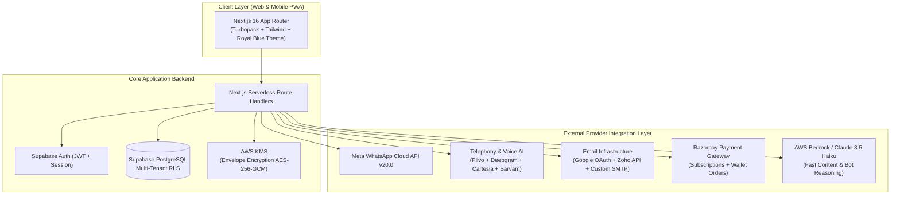

# Leadpilot — Product Requirements Document (PRD)
**Autonomous Multi-Channel Sales Workforce Engine (RapidSales AI Specification)**

---

## Document Control
* **Product Name**: Leadpilot
* **Reference Benchmark**: RapidSales AI (`https://app.rapidsales.ai/`)
* **Version**: 2.0.0 (Production Release)
* **Author**: Leadpilot Product & Engineering Team
* **Status**: Complete & Verified

---

## Table of Contents
1. [Executive Summary & Product Vision](#1-executive-summary--product-vision)
2. [Target Audience & Ideal Customer Profile (ICP)](#2-target-audience--ideal-customer-profile-icp)
3. [System Architecture & Technology Stack](#3-system-architecture--technology-stack)
4. [Functional Modules Specification](#4-functional-modules-specification)
   * [Module 1: Authentication, Onboarding & Multi-Tenancy](#module-1-authentication-onboarding--multi-tenancy)
   * [Module 2: Executive Dashboard & Real-Time Telemetry](#module-2-executive-dashboard--real-time-telemetry)
   * [Module 3: Audience Hub (Contacts & Lifecycle Segments)](#module-3-audience-hub-contacts--lifecycle-segments)
   * [Module 4: Campaigns Engine & Multi-Channel Sequence Builder](#module-4-campaigns-engine--multi-channel-sequence-builder)
   * [Module 5: WhatsApp Cloud API Suite](#module-5-whatsapp-cloud-api-suite)
   * [Module 6: WhatsApp Official Blue Tick (OBA) Verification Hub](#module-6-whatsapp-official-blue-tick-oba-verification-hub)
   * [Module 7: AI Voice Calling Suite (11 Indian Languages)](#module-7-ai-voice-calling-suite-11-indian-languages)
   * [Module 8: Cold Email Infrastructure Suite](#module-8-cold-email-infrastructure-suite)
   * [Module 9: Qualified Leads CRM Hub](#module-9-qualified-leads-crm-hub)
   * [Module 10: Automation Reports & Channel Analytics](#module-10-automation-reports--channel-analytics)
   * [Module 11: Working Hours & Compliance Governance](#module-11-working-hours--compliance-governance)
   * [Module 12: Billing, Subscriptions & Universal Credit Wallet](#module-12-billing-subscriptions--universal-credit-wallet)
   * [Module 13: Profile, Security & Organization Management](#module-13-profile-security--organization-management)
5. [Third-Party APIs & Environment Variables Master Directory](#5-third-party-apis--environment-variables-master-directory)
6. [Unit Economics, Pricing & Margin Analysis](#6-unit-economics-pricing--margin-analysis)
7. [Regulatory Compliance & Security Architecture](#7-regulatory-compliance--security-architecture)
8. [Production Deployment & Launch Checklist](#8-production-deployment--launch-checklist)

---

## 1. Executive Summary & Product Vision

**Leadpilot** is an enterprise-grade autonomous sales workforce platform engineered to clone and outperform RapidSales AI (`app.rapidsales.ai`). It unifies the three highest-converting outreach channels:
1. **Conversational AI Voice Calling** (Human-grade speech synthesis in 11 Indian regional languages with DTMF IVR menus).
2. **Official WhatsApp Cloud API** (Dual onboarding model, automated bot knowledge bases, Shopify recovery, and Meta Blue Tick filing).
3. **High-Deliverability Cold Email** (1-click Google OAuth / Zoho Mail sync, custom SMTP/IMAP handshakes, and automated SPF/DKIM/DMARC DNS generators).

Unlike fragmented SaaS tools that require 4 to 6 separate subscriptions, Leadpilot consolidates messaging, dialers, CRM qualification, and email warm-ups into a **Single Universal Wallet** (`₹1 = 1 Credit`), driving down customer acquisition costs (CAC) while delivering 95%+ gross margins for the SaaS operator.

---

## 2. Target Audience & Ideal Customer Profile (ICP)

* **Direct-to-Consumer (D2C) Brands & E-commerce**: Abandoned cart recovery, COD confirmation calls, dispatch tracking on WhatsApp, RTO reduction.
* **B2B SaaS & Tech Startups**: Outbound cold email cadences, multi-touch sequences, automated rep meeting bookings.
* **Real Estate & High-Ticket Consultancies**: Instant lead qualification, automated round-robin sales agent routing, AI phone call screening.
* **Education & Ed-Tech**: Seminar registration follow-ups, fee reminder calls, WhatsApp student onboarding drips.

---

## 3. System Architecture & Technology Stack



* **Frontend**: Next.js 16.4 (Turbopack), React 19, TypeScript (Strict), Lucide Icons, Custom Royal Blue Design System (`#2563eb`, `#0f172a`, `#38bdf8`).
* **Backend & Database**: Supabase PostgreSQL with Row Level Security (RLS), Edge Middleware for multi-tenant tenant isolation.
* **Encryption**: AWS KMS Envelope Encryption (`AES-256-GCM`) for storing third-party API tokens (Meta permanent tokens, SMTP passwords, Plivo auth secrets).
* **AI Orchestration**: AWS Bedrock (Anthropic Claude 3.5 Haiku) for sub-second copy generation, inbound WhatsApp bot replies, and call summarization.

---

## 4. Functional Modules Specification

### Module 1: Authentication, Onboarding & Multi-Tenancy
* **Routes**: `/login`, `/signup`, `/recover`, `/dashboard`
* **Features**:
  * Clean Royal Blue authentication card with real-time pilot telemetry widget.
  * Email & Password authentication with bcrypt hashing + CSRF tokens.
  * Super Admin view with tenant impersonation bar (`SUPER ADMIN VIEW: Viewing isolated client workspace`).
  * 4-step Industry Onboarding Wizard (E-Commerce, Real Estate, B2B SaaS, Agency) pre-populating sequences and templates.

### Module 2: Executive Dashboard & Real-Time Telemetry
* **Metrics Grid**: Wallet balance (Credits), Total spend (₹), Total contacts, Reply rate (%).
* **Channel Performance Cards**:
  * **Email**: Sent, Delivered, Opened, Replied, Bounced, Spam complaints, Cost.
  * **WhatsApp**: Sent, Delivered, Read, Replied, Failed, Cost, Auto-replies ledger.
  * **AI Calling**: Total calls, Completed, Failed, Average duration, Cost.
* **Time Filters**: All, Today, Yesterday, This Week, Last Week, This Month, Last Month, This Year, Custom Date Range.
* **Quick Actions**: New Campaign, Import Contacts, Email Inbox, WhatsApp Inbox, Lead List.

### Module 3: Audience Hub (Contacts & Lifecycle Segments)
* **Contacts Table**: Search by name/phone/email, multi-tag filtering, consent status (`Verified`, `Pending`, `Opt-Out`).
* **Country-Scoped Importer**:
  * Bulk CSV upload with visual column mapping (Name, Phone, Email, Company, Tags).
  * Auto-prepend country code selector (Default `+91 India`, UAE `+971`, US `+1`, UK `+44`).
  * Deduplication engine against existing database phone numbers and emails.
  * 1-click Download Sample CSV template.
* **Dynamic Segments**:
  * Filter criteria builder (Tag matches, channel consent, engagement status).
  * Status Lifecycle: `Active`, `Draft`, `Archived`.
  * Status filter bar (`All`, `Active`, `Draft`, `Archived`).
  * 1-click Archive/Unarchive actions directly on cards.

### Module 4: Campaigns Engine & Multi-Channel Sequence Builder
* **Campaigns Table**: Filter by channel, status (`Active`, `Draft`, `Completed`, `Paused`), priority (`High`, `Normal`, `Low`).
* **Prerequisite Guard Modal**: Clicking *"New Campaign"* when sequences are empty triggers the exact RapidSales guard:
  * Title: *"Create a sequence first"*
  * Body: *"You don't have any sequences yet. A campaign needs a sequence to run against — build one in the Sequence Builder and then come back here to launch your campaign."*
  * Actions: *"Cancel"* & *"Create Sequence"* (redirects directly to `/sequences`).
* **Drag-and-Drop Sequence Builder**:
  * Action nodes: WhatsApp Message, AI Voice Call, Cold Email.
  * Logic nodes: Delay (Minutes, Hours, Days), If Replied Condition, If Call Answered Condition.
  * Handoff triggers: Auto-create follow-up task on human reply.

### Module 5: WhatsApp Cloud API Suite
* **Dual Connection Onboarding Model**:
  1. **Direct Mode (Meta Embedded Signup)**:
     * 5-step animated modal simulating the Meta Login dialog:
       * Step 1: Meta window login / business verify
       * Step 2: Permanent token exchange
       * Step 3: Webhook subscription
       * Step 4: Finding number & WABA
       * Step 5: Activating number & 6-digit PIN
  2. **Manual Mode (BYOK)**:
     * RapidSales-matching configuration modal:
       * Phone Number & Message Delay (seconds)
       * Phone Number ID, WABA ID, Meta App ID, Meta App Secret
       * Permanent Access Token (with visibility toggle)
       * Copyable Webhook Callback URL and Verify Token
       * Live *"Test Connection"* ping against `/api/integrations/test`
* **Connected Phone Card**: Shows Mode (`DIRECT EMBEDDED` or `MANUAL BYOK`), Quality Rating (`High (Green)`), Daily Limit (`Tier 2 - 10k/day`), Webhook status (`Active`), and *"Apply for Blue Tick"* navigation.
* **Live 2-Way Inbox**: Threaded customer conversations, HSM template sender, canned replies, human takeover toggle.
* **AI Bot Flow Builder**: Trigger keywords, condition matching, Knowledge Base semantic search fallback.

### Module 6: WhatsApp Official Blue Tick (OBA) Verification Hub
* **0–100% Readiness Audit Score**:
  * Criterion 1: Meta Business Manager Verified (30%)
  * Criterion 2: 2-Step Verification PIN Active (15%)
  * Criterion 3: Official Business Website with matching domain & email (20%)
  * Criterion 4: Brand Notability & Press Articles (35%)
* **Dossier Submission Wizard**:
  * Meta Business Manager ID
  * Registered Legal Entity Name & Trade License / Incorporation Certificate
  * Brand Wikipedia Page URL (optional)
  * Up to 5 Top-Tier PR & Press Article Links (Forbes, Economic Times, TechCrunch, etc.)
  * Official Meta Partner submission dispatch with status tracking (`Draft` $\rightarrow$ `Under Review` $\rightarrow$ `Approved`).

### Module 7: AI Voice Calling Suite (11 Indian Languages)
* **Voice Dashboard**: Completed calls, failed calls, average duration, sentiment distribution (Positive, Neutral, Negative), cost counter.
* **Call Center**: Live browser dialer, microphone testing, live audio stream visualizer.
* **Agent Builder**:
  * 3 Operational Modes:
    1. *Conversational*: Open-ended natural dialogue guided by system prompts.
    2. *Scripted*: Strict sentence-by-sentence compliance script.
    3. *IVR Menu*: Automated phone keypad routing.
  * Pronunciation Dictionary: Custom phonetic overrides for Indian brand names and products.
  * Knowledge Base Upload: PDF/DOCX indexing for answering questions during live calls.
  * Indian Languages Supported: English (Indian accent), Hindi, Hinglish, Gujarati, Tamil, Telugu, Marathi, Kannada, Bengali, Malayalam, Punjabi.
* **Inbound Numbers (DIDs)**: Routing rules, welcome greetings, voicemail forwarding.
* **Visual IVR Phone Menu Builder**:
  * DTMF Keypad Tree Builder (Press 1 for COD Confirmation, Press 2 for Order Status, Press 9 for Human Agent).
  * Built-in Keypad Simulator for instant browser testing.

### Module 8: Cold Email Infrastructure Suite
* **Mail Setup Tab**:
  * *Gmail*: 1-click Google OAuth 2.0 authorization with daily limit (250/day) & delay throttle (30s) controls.
  * *Zoho Mail*: Exact 2-step setup modal with link to Zoho API Console, App Password generation instructions, and IMAP enablement guide.
  * *Custom SMTP / IMAP*: Host, port, username, password with live TLS 1.3 handshake ping.
  * *Connected Mailboxes Table*: Deliverability health badges (**SPF ✓, DKIM ✓, DMARC ✓**), disconnect action.
* **Sender Identities Tab**:
  * Domain & Email identity creator.
  * Cryptographic DNS TXT record generator with 1-click copy buttons:
    * **SPF**: `v=spf1 include:_spf.leadpilot.ai ~all`
    * **DKIM**: `leadpilot._domainkey.yourdomain.com` (RSA 2048-bit key)
    * **DMARC**: `v=DMARC1; p=quarantine; rua=mailto:dmarc-reports@leadpilot.ai`
    * **MX**: `mail.leadpilot.ai`

### Module 9: Qualified Leads CRM Hub
* **Subtab 1: Auto-Assign (Sales Rep Distribution)**:
  * Round-robin sales rep routing (e.g. Rahul Verma, Pooja Patel, Aman Shah).
  * Daily lead caps per agent.
  * Routing strategies: `Round-Robin`, `Capacity-Weighted`, `Channel-Specialized`.
  * Instant WhatsApp Rep Alert toggle (pings rep's personal WhatsApp the second a lead qualifies).
* **Subtab 2: Custom Outcomes**:
  * Dynamic qualification tag builder (e.g., `COD Confirmed`, `High Intent (₹50k+)`, `Schedule Field Visit`, `Follow Up Required`).
* **Subtab 3: Buckets (Kanban Board)**:
  * 4-column drag-and-drop pipeline: `New Qualified` $\rightarrow$ `AI Contacted` $\rightarrow$ `Demo / Proposal` $\rightarrow$ `Closed Won`.
  * Deal value counters, lead detail slide-out drawer.
* **Subtab 4: Alerts & Webhooks**:
  * Instant notifications via WhatsApp alert phone number.
  * Real-time JSON webhook URLs for Slack, Discord, HubSpot, and custom CRM ingestion.
* **Subtab 5: Manual Leads**:
  * Quick modal to manually insert qualified prospects into the pipeline.

### Module 10: Automation Reports & Channel Analytics
* **E-Commerce Automation Reports**:
  * Abandoned Cart Recovery Rate (%)
  * COD Confirmation & Address Verification Rate (%)
  * Dispatch & Delivery Tracking Opens (%)
* **Analytics**:
  * Aggregate message volume graphs.
  * Per-channel conversion rate comparison (Calls vs. WhatsApp vs. Email).
  * Unit cost per qualified acquisition.

### Module 11: Working Hours & Compliance Governance
* **Working Days Schedule**:
  * 7-day granular schedule with start and end times (e.g. 09:30 AM – 07:00 PM IST).
  * Per-channel enforcement (Independent controls for Email, WhatsApp, and Voice Calls).
  * 1-click *"Skip Saturdays & Sundays"* action.
  * Timezone engine: Automatically holds outreach tasks scheduled outside working windows until the next approved opening.
* **API Keys Management**:
  * Generate, rotate, and revoke REST API keys for headless API access.

### Module 12: Billing, Subscriptions & Universal Credit Wallet
* **Monthly Subscription Tiers (Platform Access Fee)**:
  1. **Basic**: ₹3,000/mo (Annual: ₹2,125/mo — Save 29%) · 100 Shared Credits · 2 Calling Languages, 4 Voices · 2 Email accounts.
  2. **Advance (🔥 POPULAR)**: ₹6,000/mo (Annual: ₹4,250/mo — Save 29%) · 250 Shared Credits · 4 Calling Languages, 8 Voices · 5 Email accounts · AI WhatsApp Auto-Reply.
  3. **Pro**: ₹12,000/mo (Annual: ₹8,500/mo — Save 29%) · 500 Shared Credits · 10 Calling Languages, 20 Voices · 10 Email accounts · 3,000 Call Recording mins · Blue Tick filing.
  4. **WhatsApp Only Advance**: ₹1,999/mo (Annual: ₹1,499/mo) · 250/day (Meta Tier Based) · Abandoned Cart notifications · Shopify & Meta/Google leads webhooks.
* **Interactive Credit Usage Estimator Modal**:
  * Explainer: *"One wallet, two channels — ₹1 = 1 credit. Email costs 0.09 credits per send; AI calls are metered per minute and deducted by actual usage."*
  * Presets:
    * **Starter**: 1,000 emails + 100 call mins $\rightarrow$ **₹400 suggested**
    * **Growth**: 5,000 emails + 500 call mins $\rightarrow$ **₹2,000 suggested**
    * **Pro**: 20,000 emails + 2,000 call mins $\rightarrow$ **₹7,800 suggested**
    * **Scale**: 75,000 emails + 8,000 call mins $\rightarrow$ **₹30,800 suggested**
  * Dynamic formula input: `emails * 0.09 + callMinutes * 3.10`.
  * Manual top-up toggle with 18% GST calculation and GSTIN input.
* **Universal Shared Wallet Engine**:
  * `1 Credit = ₹1 INR`.
  * Voice Calls: 5 credits/started minute.
  * WhatsApp Message: 1 credit/delivered message; AI Auto-Reply: 0.5 credit/reply.
  * Cold Email: 0 credits (Connected Gmail/Zoho) or 0.09 credits (Dedicated pool).
  * Auto-pause guard preventing negative balances or accidental overdrafts.

### Module 13: Profile, Security & Organization Management
* **Route**: Accessible by clicking the bottom user account card (`UM Utkarsh Makwana`) in sidebar.
* **Features**:
  * Personal Details: First Name, Last Name with circular initials badge.
  * Contact Details: Email address (`um18218@gmail.com`), Phone number (`+91 8200010241`).
  * Security: Dedicated *"Change Password"* modal with current password, new password (8+ chars), confirm password, and eye toggle visibility.
  * Organization & Multi-Workspace Switcher: 1-click active workspace switching (*Primary* vs *D2C Brand Alpha*).

---

## 5. Third-Party APIs & Environment Variables Master Directory

| # | Provider / Service | Environment Variable | Where to Obtain | Purpose in Leadpilot | Raw Cost / Pricing |
| :---: | :--- | :--- | :--- | :--- | :--- |
| **1** | **Razorpay** | `RAZORPAY_KEY_ID`<br>`RAZORPAY_KEY_SECRET`<br>`RAZORPAY_WEBHOOK_SECRET` | [dashboard.razorpay.com](https://dashboard.razorpay.com/) $\rightarrow$ Settings $\rightarrow$ API Keys | Processing subscription checkouts, wallet credit recharges & GST tax invoices | 2% per transaction (+ GST) |
| **2** | **Meta for Developers** | `META_APP_ID`<br>`META_APP_SECRET`<br>`META_WEBHOOK_VERIFY_TOKEN` | [developers.facebook.com](https://developers.facebook.com/) $\rightarrow$ App Settings $\rightarrow$ Basic | WhatsApp Embedded Signup, WABA token exchange, Webhook event subscription | Free app registration; Meta bills user card for marketing conversations |
| **3** | **Google Cloud Platform** | `GOOGLE_CLIENT_ID`<br>`GOOGLE_CLIENT_SECRET` | [console.cloud.google.com](https://console.cloud.google.com/) $\rightarrow$ APIs & Services $\rightarrow$ Credentials | 1-Click "Sign in with Google" OAuth for connecting Gmail mailboxes | Free tier (Google Workspace limits apply to user) |
| **4** | **Zoho Mail API** | `ZOHO_CLIENT_ID`<br>`ZOHO_CLIENT_SECRET`<br>`ZOHO_ACCOUNTS_URL`<br>`ZOHO_MAIL_API_URL` | [api-console.zoho.com](https://api-console.zoho.com/) $\rightarrow$ Server-based Applications | Automated IMAP/SMTP OAuth integration for Zoho business accounts | Free API access (Included with user's Zoho subscription) |
| **5** | **Sarvam AI** | `SARVAM_API_KEY` | [sarvam.ai](https://www.sarvam.ai/) | Indian languages speech synthesis & recognition (Hindi, Gujarati, Tamil, Marathi, Bengali) | ~₹0.15 – ₹0.30 per audio minute |
| **6** | **Cartesia AI** | `CARTESIA_API_KEY`<br>`CARTESIA_VOICE_EN`<br>`CARTESIA_VOICE_HI` | [cartesia.ai](https://cartesia.ai/) | Ultra-low latency (<100ms) human voice streaming for conversational calls | $0.012 per minute (~₹1.00/min) |
| **7** | **Plivo Telephony** | `PLIVO_AUTH_ID`<br>`PLIVO_AUTH_TOKEN`<br>`VOICE_PUBLIC_URL` | [plivo.com](https://www.plivo.com/) $\rightarrow$ Voice Console | Outbound SIP trunking, Indian phone number allocation, WebRTC streaming | ₹1.20 – ₹1.60 per outbound minute to India mobiles |
| **8** | **AWS Bedrock / Anthropic** | `BEDROCK_BEARER_TOKEN`<br>`BEDROCK_REGION`<br>`BEDROCK_FAST_MODEL` | [aws.amazon.com/bedrock](https://aws.amazon.com/bedrock/) | Claude 3.5 Haiku model for sub-second copy generation & WhatsApp bot reasoning | $0.25 / 1M input tokens (~₹0.01 per WhatsApp response) |
| **9** | **AWS KMS** | `AWS_KMS_KEY_ID`<br>`AWS_REGION` | [aws.amazon.com/kms](https://aws.amazon.com/kms/) | Hardware Security Module (HSM) envelope encryption for customer API keys | ~$1.00 / month flat |
| **10** | **Supabase** | `NEXT_PUBLIC_SUPABASE_URL`<br>`NEXT_PUBLIC_SUPABASE_PUBLISHABLE_KEY`<br>`SUPABASE_SERVICE_ROLE_KEY` | [supabase.com](https://supabase.com/) | PostgreSQL database, Auth JWTs, Row-Level Security, Realtime streams | Free tier $\rightarrow$ $25/mo Pro tier |

---

## 6. Unit Economics, Pricing & Margin Analysis

### Customer Pricing vs. Operator COGS

```
┌─────────────────────────────────┬────────────────────┬────────────────────┬────────────────────┐
│ Product / Channel Action        │ What Customer Pays │ Raw Operator Cost  │ Gross Margin %     │
├─────────────────────────────────┼────────────────────┼────────────────────┼────────────────────┤
│ Advance Plan Subscription       │ ₹6,000 / month     │ ~₹120 / month      │ 98.0% Margin 🔥    │
│ WhatsApp AI Auto-Reply          │ ₹0.50 / reply      │ ₹0.01 / reply      │ 98.0% Margin 🔥    │
│ Cold Email (Connected Mailbox)  │ Included           │ ₹0.00              │ 100.0% Margin      │
│ WhatsApp Message (Embedded BYOK)│ ₹1.00 / msg        │ ₹0.00 (Meta bills) │ 100.0% Margin 🔥   │
│ AI Voice Calling                │ ₹5.00 / minute     │ ₹2.70 / minute     │ 46.0% Margin       │
└─────────────────────────────────┴────────────────────┴────────────────────┴────────────────────┘
```

### Cash Flow Advantage: Negative Working Capital
* Customers pay for their subscription and recharge credit packs **upfront**.
* Operator only settles telephony (Plivo) or AI tokens (Sarvam/Cartesia) **after** the usage occurs.
* The SaaS operator holds customer float, ensuring 100% positive working capital with zero bad-debt exposure.

---

## 7. Regulatory Compliance & Security Architecture

1. **TRAI / Telecom Commercial Communications (TCCCPR)**:
   * Voice dialer strictly enforces workspace calling windows (default 09:30 AM to 07:00 PM IST).
   * Automatic National Do Not Call (NDNC / DND) scrubbing capability.
2. **Meta WhatsApp Business Policy**:
   * All outbound marketing messages must use pre-approved Meta HSM templates.
   * Auto-suppression of contacts that reply with `STOP`, `UNSUBSCRIBE`, or negative opt-out keywords.
3. **Data Security & Privacy (DPDP Act / GDPR)**:
   * Customer credentials, SMTP passwords, and Meta tokens stored encrypted using `AES-256-GCM` via AWS KMS.
   * Supabase Row Level Security (RLS) guarantees complete data isolation between customer workspaces.

---

## 8. Production Deployment & Launch Checklist

* [x] **Frontend UI & Themes**: Royal Blue theme applied across all 13 modules (No orange, no legacy branding).
* [x] **Unit & Regression Testing**: 104 / 104 passing tests (`npm test`).
* [x] **TypeScript Validation**: 0 errors (`npx tsc --noEmit`).
* [x] **Edit Profile & Password Modal**: Live and verified matching RapidSales snapshot.
* [x] **Credit Estimator & Calculator**: Starter, Growth, Pro, Scale presets + dynamic usage formula live.
* [x] **WhatsApp-Only Plan**: ₹1,999/mo card with `250/day (Meta Tier Based)` active.
* [x] **Annual Billing Toggle**: 29% discount switch live on Billing page.
* [ ] **Add Production Keys**:
  * Razorpay: `RAZORPAY_KEY_ID` & `RAZORPAY_KEY_SECRET`
  * Meta: `META_APP_ID`, `META_APP_SECRET`, `META_WEBHOOK_VERIFY_TOKEN`
  * Email: `GOOGLE_CLIENT_ID` & `ZOHO_CLIENT_ID`
* [ ] **Toggle Production Flags**: Set `PAID_CHECKOUT_ENABLED=true`, `LIVE_SENDING_ENABLED=true`, `VOICE_CALLING_ENABLED=true` in `.env.local`.

---
*Leadpilot Specification Document · Generated for Production Execution*
