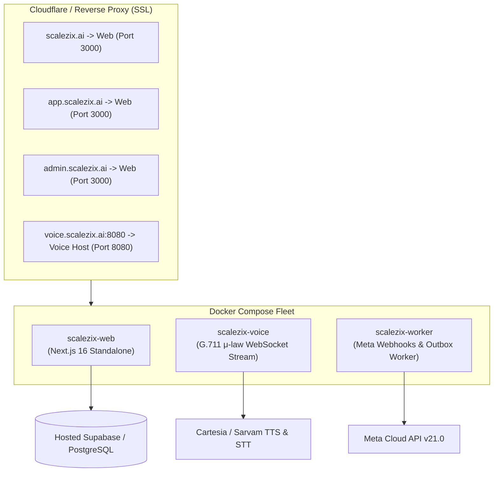

# Scalezix Production Deployment & Operations Runbook

This guide contains the step-by-step procedure to deploy **Scalezix** to production on any cloud server (AWS, DigitalOcean, Hetzner, VPS, or Railway) using Docker Compose and multi-subdomain wildcard DNS.

---

## 1. Production Architecture

Scalezix runs as 3 containerized microservices:



---

## 2. Server Prerequisites

* **Hardware:** Minimum 2 vCPU, 4GB RAM (Ubuntu 22.04 / 24.04 LTS).
* **Software:** Docker Engine 24+ & Docker Compose v2.
* **Firewall Ports:**
  * `80` (HTTP for Let's Encrypt / Certbot)
  * `443` (HTTPS for Web traffic)
  * `8080` (WebSocket port for Plivo real-time audio streams)

---

## 3. Step-by-Step Deployment

### Step 1: Clone Repository & Configure `.env.production`
```bash
git clone <your-repo-url> /opt/scalezix
cd /opt/scalezix
cp .env.example .env.production
```

Update your `.env.production` with live production secrets:
```env
NEXT_PUBLIC_APP_URL=https://scalezix.ai
NEXT_PUBLIC_SUPABASE_URL=https://your-project.supabase.co
NEXT_PUBLIC_SUPABASE_PUBLISHABLE_KEY=your-publishable-key
SUPABASE_SERVICE_ROLE_KEY=your-service-role-key

# Razorpay Production Keys
RAZORPAY_KEY_ID=rzp_live_xxxxxxxx
RAZORPAY_KEY_SECRET=your_razorpay_secret
RAZORPAY_WEBHOOK_SECRET=your_webhook_secret

# Meta Cloud API
META_APP_ID=your_app_id
META_APP_SECRET=your_app_secret
META_WEBHOOK_VERIFY_TOKEN=your_verify_token

# AI Voice Telephony & Speech
VOICE_PUBLIC_URL=https://voice.scalezix.ai
SARVAM_API_KEY=your_sarvam_key
CARTESIA_API_KEY=your_cartesia_key

# Release Gate Flags (Set to true for live paid operations)
LIVE_SENDING_ENABLED=true
PAID_CHECKOUT_ENABLED=true
VOICE_CALLING_ENABLED=true
```

### Step 2: Apply Supabase Database Migrations
Run all migrations against your production Supabase database:
```bash
npx supabase db push
```

### Step 3: Launch Docker Fleet
```bash
docker compose up -d --build
```

Verify that all three containers are healthy:
```bash
docker compose ps
# Output:
# scalezix-web      Up (healthy)   0.0.0.0:3000->3000/tcp
# scalezix-voice    Up (healthy)   0.0.0.0:8080->8080/tcp
# scalezix-worker   Up             
```

---

## 4. DNS & SSL Setup (Nginx / Cloudflare)

Configure Nginx as a reverse proxy:

```nginx
# Public Marketing & Client App (Wildcard Subdomain)
server {
    server_name scalezix.ai www.scalezix.ai app.scalezix.ai admin.scalezix.ai;

    location / {
        proxy_pass http://127.0.0.1:3000;
        proxy_set_header Host $host;
        proxy_set_header X-Real-IP $remote_addr;
        proxy_set_header X-Forwarded-For $proxy_add_x_forwarded_for;
        proxy_set_header X-Forwarded-Proto $scheme;
    }
}

# Voice WebSocket Streaming Host
server {
    server_name voice.scalezix.ai;

    location / {
        proxy_pass http://127.0.0.1:8080;
        proxy_http_version 1.1;
        proxy_set_header Upgrade $http_upgrade;
        proxy_set_header Connection "Upgrade";
        proxy_set_header Host $host;
    }
}
```

---

## 5. Operations & Health Checks

* **Health Endpoint:** `https://scalezix.ai/api/health`
* **Super Admin Portal:** `https://admin.scalezix.ai`
* **Client SaaS Workspace:** `https://app.scalezix.ai`
* **Restarting Services:** `docker compose restart web worker voice`
* **Viewing Live Logs:** `docker compose logs -f --tail=100`

